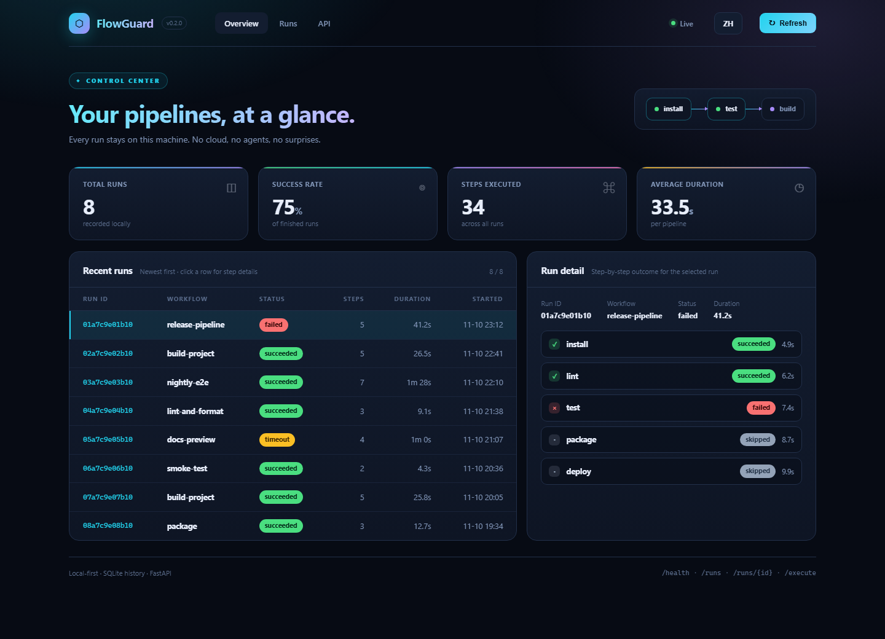
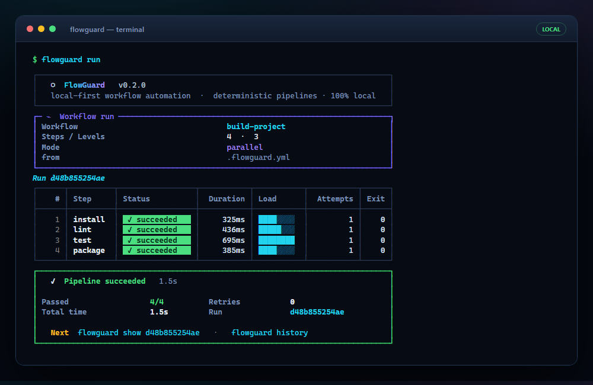

# FlowGuard

[](https://github.com/flowguard/flowguard/actions/workflows/ci.yml)
[](https://www.python.org)
[](https://github.com/astral-sh/ruff)
[](LICENSE)
[](src/flowguard/py.typed)

**English** (default) · [简体中文](README.zh-CN.md)

**FlowGuard is a local-first workflow automation engine.** Define a pipeline
in a single `.flowguard.yml` file and FlowGuard executes it deterministically
on your machine — with dependencies, parallelism, timeouts, retries, run
history, a polished terminal UI, an optional web dashboard, and a REST API.
No cloud, no agents, no external services.

It is a lightweight alternative to CI/CD workflow systems for individual
developers and small teams. It is *not* a cloud CI platform.

---

## Screenshots

### Web dashboard

`flowguard serve` opens a self-contained, dependency-free dashboard at
`http://127.0.0.1:8642/`:



### Terminal UI

`flowguard run` renders a branded header, a dependency-aware run plan,
colour-coded status pills, duration bars, and a verdict panel:



Both views are available in English (default) and Simplified Chinese. Set
`FLOWGUARD_LANG=zh`, pass `--lang zh` to the CLI, or open
`/?lang=zh` in the browser.

```yaml
workflow:
  name: build-project
  steps:
    - name: install
      command: [npm, install]

    - name: test
      command: [npm, test]
      depends_on: [install]
      retry:
        attempts: 3

    - name: build
      command: [npm, run, build]
      depends_on: [test]
      timeout: 300
      artifacts:
        - dist/*
```

---

## Why FlowGuard?

- **Deterministic** — the same workflow file, the same steps, the same
  ordering guarantees. Steps run only after their `depends_on` steps have
  succeeded; independent steps run in parallel.
- **Local-first** — everything happens on your machine: subprocess
  execution, SQLite run history, artifact files. Nothing leaves your box.
- **Fail loudly, recover politely** — per-step timeouts terminate the whole
  process tree (including shell grandchildren); per-step retry policies with
  exponential backoff absorb flaky steps; failed steps skip exactly their
  descendants, never the whole pipeline.
- **Inspectable** — every run (stdout, stderr, exit codes, durations,
  retries, event log) is stored in SQLite and queryable from the CLI, the
  dashboard, or the REST API. Step logs are written for every step to
  `.flowguard/artifacts/<run-id>/logs/`.
- **Extensible** — a small plugin interface hooks into the pipeline and
  step lifecycle.

## Installation

Requires **Python 3.12+**. Works on Windows, Linux, and macOS.

```console
$ pip install flowguard
```

Or from a checkout of this repository:

```console
$ pip install -e ".[dev]"
```

## Quickstart

```console
$ flowguard init        # write a starter .flowguard.yml
$ flowguard validate    # check it — errors are human-readable
$ flowguard run         # execute it
$ flowguard history     # browse past runs
$ flowguard serve       # open the web dashboard + REST API
```

### CLI reference

| Command                 | Description                                              |
| ----------------------- | -------------------------------------------------------- |
| `flowguard init`        | Create a starter `.flowguard.yml` (`--force` overwrites) |
| `flowguard validate`    | Validate a workflow file without running it              |
| `flowguard run [FILE]`  | Execute a workflow                                       |
| `flowguard history`     | List recent runs (`--workflow`, `--status`, `--limit`)   |
| `flowguard show RUN_ID` | Step-level detail for one run                            |
| `flowguard serve`       | Serve the dashboard and REST API (`--host`, `--port`)    |

Useful `run` options:

- `--step NAME` — run only the named steps (plus everything they depend on)
- `--env KEY=VALUE` — environment overrides, repeatable
- `--no-parallel` — force sequential execution
- `--db PATH` — use a specific SQLite history database
- `--no-artifacts` — skip artifact collection **and** step log files

Global options:

- `--version` — print the FlowGuard version
- `--lang en|zh` — UI language (default `en`); also reads `FLOWGUARD_LANG`

Exit codes: `0` success, `1` workflow or validation failure, `2` usage
error, `130` interrupted.

## Configuration reference

The default file name is `.flowguard.yml` (`.flowguard.yaml` also works).

```yaml
workflow:
  name: my-workflow          # required; letters, digits, . _ -
  environment:               # inherited by every step
    PYTHONUNBUFFERED: "1"

  steps:
    - name: test             # required; unique within the workflow
      command: [pytest, -q]  # required; list of args OR a shell string
      timeout: 600           # seconds; process tree is killed on expiry
      working_dir: packages/api
      environment:           # merged over workflow/process env
        COVERAGE_FILE: .coverage
      depends_on: [install]  # steps that must succeed first
      retry:                 # re-run on failure or timeout
        attempts: 3          # total attempts (default 1 = no retry)
        delay: 2             # seconds before first retry
        backoff_factor: 2.0  # exponential backoff multiplier
        max_delay: 30        # cap for a single retry delay
      artifacts:             # glob patterns copied after the step
        - reports/*.xml
        - dist/
```

Semantics worth knowing:

- **Commands** — a list (`[npm, install]`) is executed directly, without a
  shell. A string (`"npm install && npm test"`) or a one-element list
  holding a full command line (`[npm install]`) runs through the platform
  shell (`cmd.exe` on Windows, `/bin/sh` elsewhere).
- **Environment** — layers merge in priority order: parent process <
  workflow `environment` < step `environment` < `--env` overrides. Values
  must be strings.
- **Dependencies** — `depends_on` steps must have succeeded. A failed or
  timed-out step marks its transitive dependents `skipped`; independent
  branches keep running.
- **Parallelism** — steps whose dependencies are satisfied run
  concurrently (asyncio + a thread pool); `--no-parallel` serialises.
- **Working directory** — relative `working_dir` values resolve against
  the directory containing the workflow file (for inline API configs, the
  server's current directory).
- **Artifacts** — copied into `.flowguard/artifacts/<run-id>/<step>/`.
  Patterns must be relative to the working directory and cannot escape it;
  step logs land in `.flowguard/artifacts/<run-id>/logs/`. An invalid
  artifact pattern fails that step rather than crashing the pipeline.
- **Retries** — output from every attempt is preserved as a labelled
  transcript in the step's `stdout` / `stderr`.
- **History** — stored in `.flowguard/flowguard.db` (override with
  `--db` or by passing a path to the API factory).

### Validation errors are for humans

```yaml
workflow:
  name: broken
  steps:
    - name: build
      command: [make]
      depends_on: [test]     # typo: no step called "test"
    - name: build            # duplicate name
      command: [make, all]
```

```text
Invalid workflow configuration in .flowguard.yml:
  - step 'build' (#1): depends on unknown step(s): 'test'
  - duplicate step name(s): 'build'
```

Cycles are reported with the concrete path, e.g.
`dependency cycle detected: a -> b -> c -> a`. Field-level mistakes (bad
step names, empty commands, non-string environment values, unknown retry
options) are reported together with their exact location.

## Web dashboard and REST API

FlowGuard ships an optional local service (FastAPI). `flowguard serve`
binds to `127.0.0.1:8642` by default:

```console
$ flowguard serve            # http://127.0.0.1:8642/
```

The dashboard is a single self-contained HTML page — no CDN, no build
step, no external requests. It shows KPI cards, recent runs, and a
step-by-step detail view, and refreshes from the REST API. Switch language
with the `ZH` / `EN` button or `?lang=zh`.

| Endpoint            | Description                                        |
| ------------------- | -------------------------------------------------- |
| `GET /`             | Web dashboard (excluded from the OpenAPI schema)   |
| `GET /health`       | Liveness + version                                 |
| `GET /runs`         | List runs (`limit`, `offset`, `workflow`, `status`) |
| `GET /runs/{id}`    | One run with steps and the event log               |
| `POST /execute`     | Execute a workflow (by `path` or inline `config`)  |
| `GET /docs`         | Interactive OpenAPI documentation                  |

```console
$ curl http://127.0.0.1:8642/health
{"status":"ok","version":"0.2.0"}

$ curl -X POST http://127.0.0.1:8642/execute \
    -H "Content-Type: application/json" \
    -d '{"path": ".flowguard.yml"}'
{"run": {...}, "steps": [...], "status": "succeeded"}
```

For `POST /execute` with `path`, relative `working_dir` values resolve
against the workflow file's directory. Interactive API docs live at `/docs`.

## Plugins

Plugins observe pipeline execution. Subclass `flowguard.plugins.Plugin`
and override what you need:

```python
# mycompany/flowguard_plugins.py
from flowguard.plugins import PipelineContext, Plugin


class Notify(Plugin):
    name = "notify"

    def before_pipeline(self, context: PipelineContext) -> None:
        print(f"run {context.run_id} starting")

    def after_step(self, context, step, result) -> None:
        if not result.succeeded:
            print(f"step {step.name} failed: {result.error}")

    def after_pipeline(self, context, result) -> None:
        print(f"run {context.run_id}: {result.status.value}")
```

Load it programmatically:

```python
from flowguard.plugins import PluginManager

plugins = PluginManager()
plugins.load_from_spec("mycompany.flowguard_plugins:Notify")
```

or advertise it via the `flowguard.plugins` entry-point group in your
package metadata:

```toml
[project.entry-points."flowguard.plugins"]
notify = "mycompany.flowguard_plugins:Notify"
```

Hook errors never abort a pipeline — they are recorded in the run's event
log. The four hooks are `before_pipeline`, `before_step`, `after_step`,
and `after_pipeline`.

## Architecture

```
src/flowguard/
├── core/
│   ├── models.py       # Workflow, Step, RetryPolicy, results (Pydantic)
│   ├── engine.py       # asyncio engine: scheduling, parallelism, hooks
│   └── scheduler.py    # DAG: topological sort, levels, cycle detection
├── config/
│   └── parser.py       # YAML loading + human-readable validation
├── runner/
│   ├── executor.py     # subprocess + process-tree termination
│   └── retry.py        # retries with exponential backoff
├── storage/
│   ├── database.py     # SQLite run history
│   └── artifacts.py    # sandboxed artifact + log collection
├── cli/
│   ├── commands.py     # Typer commands
│   └── presentation.py # Rich visual system (panels, pills, tables)
├── api/
│   ├── app.py          # FastAPI factory
│   ├── routes.py       # REST endpoints + dashboard route
│   ├── dashboard.py    # server-side HTML rendering
│   └── dashboard.html  # self-contained dashboard template
├── plugins/
│   ├── base.py         # Plugin interface + PipelineContext
│   ├── manager.py      # registration, entry points, safe dispatch
│   └── builtin.py      # built-in LoggingPlugin
└── i18n.py             # English / Chinese UI string catalog
```

Execution model: the engine computes dependency levels from the DAG, then
repeatedly launches every ready step. Blocking subprocess work (with its
retry loop, timeout, and artifact collection) runs in a
`ThreadPoolExecutor` dispatched by asyncio, so independent steps proceed
concurrently while dependencies are strictly honoured.

## Development

```console
$ pip install -e ".[dev]"
$ pytest                # full test suite (300+ tests)
$ ruff check .          # lint
$ ruff format --check . # formatting
```

The repository dogfoods FlowGuard: `.flowguard.yml` at the repo root runs
lint and the test suite via FlowGuard itself. `tests/test_docs.py` enforces
that both READMEs embed the correct language screenshots and that the
Security / License sections stay in English.

Screenshots are regenerated from the real UI (a Chromium-based browser is
required) with:

```console
$ python scripts/capture_screenshots.py
```

## Security

> This section is intentionally written in English.

FlowGuard executes the commands in a workflow file as local subprocesses
with the privileges of the user running it. A workflow file is therefore
**executable code**: only run `.flowguard.yml` files you trust, and review
workflow files received from others before executing them.

- The REST API has **no authentication**. `POST /execute` can run arbitrary
  commands from a supplied path or an inline config. `flowguard serve`
  binds to `127.0.0.1` by default; binding to a non-loopback interface
  (`--host 0.0.0.0`) exposes an unauthenticated command executor. Only do
  this on a trusted, firewalled network.
- There is no sandbox around command execution. Timeouts terminate the
  whole process tree, but they do not restrict filesystem or network
  access.
- Artifact globs are confined to the step's working directory. Absolute
  patterns, `..` traversal, and symlinks resolving outside that directory
  are rejected.
- Run history (including captured stdout/stderr) is stored unencrypted in
  a local SQLite file. Treat `.flowguard/` as sensitive and keep it out of
  version control (it is gitignored by default).
- Environment variables from `--env`, workflow files, and the API are
  passed to child processes; avoid putting secrets in committed workflow
  files.
- To report a vulnerability, please open a private security advisory on
  the repository's GitHub Security tab rather than a public issue.

## License

Released under the [MIT License](LICENSE). Copyright (c) 2026 FlowGuard
Contributors. See [LICENSE](LICENSE) for the full text.
