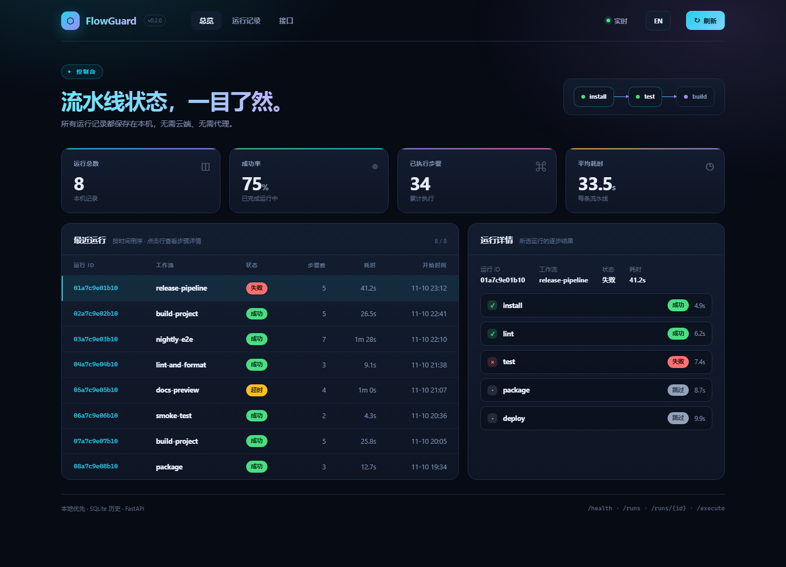
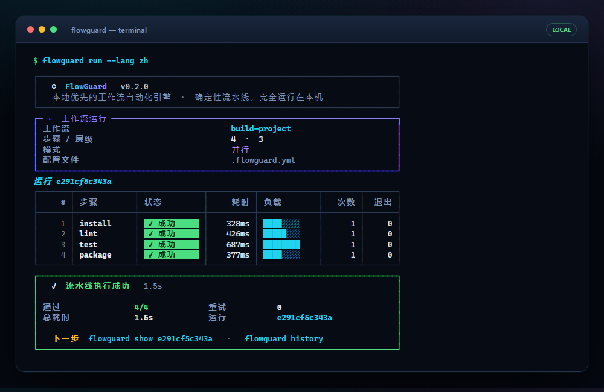

# FlowGuard

[](https://github.com/flowguard/flowguard/actions/workflows/ci.yml)
[](https://www.python.org)
[](https://github.com/astral-sh/ruff)
[](LICENSE)
[](src/flowguard/py.typed)

**简体中文** · [English (default)](README.md)

**FlowGuard 是一个本地优先的工作流自动化引擎。** 只需在一个
`.flowguard.yml` 文件中定义流水线，FlowGuard 就会在本机确定性地执行它：
支持依赖、并行、超时、重试、运行历史、精美的终端界面、可选的 Web
仪表盘以及 REST API。无需云端、无需代理、无需任何外部服务。

它是面向个人开发者与小型团队的轻量级 CI/CD 工作流替代方案，**不是**
云端 CI 平台。

---

## 界面截图

### Web 仪表盘

执行 `flowguard serve` 后，访问 `http://127.0.0.1:8642/` 即可打开完全自包含、
无任何外部依赖的仪表盘：



### 终端界面

`flowguard run` 会展示品牌头部、依赖关系运行计划、彩色状态标签、耗时条
与结论面板：



两种界面均支持英文（默认）与简体中文。设置 `FLOWGUARD_LANG=zh`、在 CLI
中使用 `--lang zh`，或在浏览器打开 `/?lang=zh` 即可切换语言。

```yaml
workflow:
  name: build-project
  steps:
    - name: install
      command: [npm, install]

    - name: test
      command: [npm, test]
      depends_on: [install]
      retry:
        attempts: 3

    - name: build
      command: [npm, run, build]
      depends_on: [test]
      timeout: 300
      artifacts:
        - dist/*
```

---

## 为什么选择 FlowGuard？

- **确定性** —— 同一份工作流文件、同样的步骤、同样的顺序保证。步骤仅在
  `depends_on` 依赖成功后执行；互不依赖的步骤并行运行。
- **本地优先** —— 子进程执行、SQLite 运行历史、产物文件都在本机完成，
  数据不会离开你的电脑。
- **明确失败，优雅恢复** —— 步骤超时会终止整个进程树（包括 shell 派生
  的子进程）；带指数退避的重试策略吸收偶发失败；失败步骤只跳过其下游
  依赖分支，不会中断整条流水线。
- **可追溯** —— 每次运行的 stdout、stderr、退出码、耗时、重试次数与事件
  日志都写入 SQLite，可在 CLI、仪表盘或 REST API 中查询。每个步骤的日志
  都会保存到 `.flowguard/artifacts/<run-id>/logs/`。
- **可扩展** —— 简洁的插件接口可挂载到流水线与步骤生命周期。

## 安装

需要 **Python 3.12+**，支持 Windows、Linux 与 macOS。

```console
$ pip install flowguard
```

或从本仓库源码安装：

```console
$ pip install -e ".[dev]"
```

## 快速开始

```console
$ flowguard init        # 生成 .flowguard.yml 模板
$ flowguard validate    # 校验配置，错误信息可读
$ flowguard run         # 执行工作流
$ flowguard history     # 查看历史运行
$ flowguard serve       # 启动 Web 仪表盘与 REST API
```

### 命令参考

| 命令                    | 说明                                                |
| ----------------------- | --------------------------------------------------- |
| `flowguard init`        | 生成 `.flowguard.yml` 模板（`--force` 覆盖）       |
| `flowguard validate`    | 仅校验工作流文件，不执行                          |
| `flowguard run [FILE]`  | 执行工作流                                        |
| `flowguard history`     | 列出近期运行（`--workflow`、`--status`、`--limit`）|
| `flowguard show RUN_ID` | 查看某次运行的步骤详情                            |
| `flowguard serve`       | 启动仪表盘与 REST API（`--host`、`--port`）        |

`run` 常用参数：

- `--step NAME` —— 只运行指定步骤（含其所有依赖）
- `--env KEY=VALUE` —— 环境变量覆盖，可重复使用
- `--no-parallel` —— 强制串行执行
- `--db PATH` —— 指定 SQLite 历史数据库
- `--no-artifacts` —— 同时跳过产物收集与步骤日志文件

全局参数：

- `--version` —— 输出 FlowGuard 版本号
- `--lang en|zh` —— 界面语言（默认 `en`），同时读取 `FLOWGUARD_LANG`

退出码：`0` 成功、`1` 工作流或校验失败、`2` 用法错误、`130` 被中断。

## 配置参考

默认文件名为 `.flowguard.yml`（也支持 `.flowguard.yaml`）。

```yaml
workflow:
  name: my-workflow          # 必填；字母、数字、. _ -
  environment:               # 由所有步骤继承
    PYTHONUNBUFFERED: "1"

  steps:
    - name: test             # 必填；同一工作流内唯一
      command: [pytest, -q]  # 必填；参数列表或 shell 字符串
      timeout: 600           # 秒；超时终止整个进程树
      working_dir: packages/api
      environment:           # 覆盖工作流 / 进程环境
        COVERAGE_FILE: .coverage
      depends_on: [install]  # 必须先成功的步骤
      retry:                 # 失败或超时后重试
        attempts: 3          # 总尝试次数（默认 1，即不重试）
        delay: 2             # 首次重试前的等待秒数
        backoff_factor: 2.0  # 指数退避倍数
        max_delay: 30        # 单次重试等待上限
      artifacts:             # 步骤结束后复制的产物
        - reports/*.xml
        - dist/
```

需要了解的语义：

- **命令** —— 列表（`[npm, install]`）不经过 shell 直接执行；字符串
  （`"npm install && npm test"`）或仅含一条完整命令行的单元素列表
  （`[npm install]`）会通过平台 shell 执行（Windows 为 `cmd.exe`，
  其他平台为 `/bin/sh`）。
- **环境变量** —— 按优先级合并：父进程 < 工作流 `environment` < 步骤
  `environment` < `--env` 覆盖；值必须是字符串。
- **依赖** —— `depends_on` 中的步骤必须成功。失败或超时的步骤会将其
  所有传递依赖标记为 `skipped`，其他独立分支继续执行。
- **并行** —— 依赖已满足的步骤并发执行（asyncio + 线程池）；
  `--no-parallel` 可强制串行。
- **工作目录** —— 相对 `working_dir` 相对于工作流文件所在目录解析
  （API 内联配置则以服务进程当前目录为基准）。
- **产物** —— 复制到 `.flowguard/artifacts/<run-id>/<step>/`。产物模式
  必须相对于工作目录且不能越界；步骤日志位于
  `.flowguard/artifacts/<run-id>/logs/`。非法产物模式只会让该步骤失败，
  不会导致整条流水线崩溃。
- **重试** —— 每次尝试的输出都会以带标注的记录保留在步骤的
  `stdout` / `stderr` 中。
- **历史** —— 保存于 `.flowguard/flowguard.db`（可用 `--db` 或向 API
  工厂传入路径覆盖）。

### 面向人的校验错误

```yaml
workflow:
  name: broken
  steps:
    - name: build
      command: [make]
      depends_on: [test]     # 拼写错误：不存在 "test" 步骤
    - name: build            # 步骤名重复
      command: [make, all]
```

```text
Invalid workflow configuration in .flowguard.yml:
  - step 'build' (#1): depends on unknown step(s): 'test'
  - duplicate step name(s): 'build'
```

循环依赖会给出具体路径，例如
`dependency cycle detected: a -> b -> c -> a`。字段级错误（非法步骤名、
空命令、非字符串环境变量值、未知的重试选项）会连同精确位置一起报告。

## Web 仪表盘与 REST API

FlowGuard 附带可选的本地服务（FastAPI）。`flowguard serve` 默认绑定
`127.0.0.1:8642`：

```console
$ flowguard serve            # http://127.0.0.1:8642/
```

仪表盘是单个自包含 HTML 页面 —— 没有 CDN、没有构建步骤、没有外部请求。
它展示 KPI 卡片、最近运行列表与逐步详情，并从 REST API 刷新数据。点击
`ZH` / `EN` 按钮或访问 `?lang=zh` 可切换语言。

| 接口                | 说明                                               |
| ------------------- | -------------------------------------------------- |
| `GET /`             | Web 仪表盘（不计入 OpenAPI schema）                |
| `GET /health`       | 存活探测与版本号                                  |
| `GET /runs`         | 列出运行（`limit`、`offset`、`workflow`、`status`）|
| `GET /runs/{id}`    | 单次运行、步骤结果与事件日志                      |
| `POST /execute`     | 执行工作流（`path` 或内联 `config`）               |
| `GET /docs`         | 交互式 OpenAPI 文档                               |

```console
$ curl http://127.0.0.1:8642/health
{"status":"ok","version":"0.2.0"}

$ curl -X POST http://127.0.0.1:8642/execute \
    -H "Content-Type: application/json" \
    -d '{"path": ".flowguard.yml"}'
{"run": {...}, "steps": [...], "status": "succeeded"}
```

通过 `POST /execute` 的 `path` 执行时，相对 `working_dir` 会基于工作流
文件所在目录解析。交互式 API 文档位于 `/docs`。

## 插件

插件用于观察流水线执行过程。继承 `flowguard.plugins.Plugin` 并按需覆写：

```python
# mycompany/flowguard_plugins.py
from flowguard.plugins import PipelineContext, Plugin


class Notify(Plugin):
    name = "notify"

    def before_pipeline(self, context: PipelineContext) -> None:
        print(f"run {context.run_id} starting")

    def after_step(self, context, step, result) -> None:
        if not result.succeeded:
            print(f"step {step.name} failed: {result.error}")

    def after_pipeline(self, context, result) -> None:
        print(f"run {context.run_id}: {result.status.value}")
```

以代码方式加载：

```python
from flowguard.plugins import PluginManager

plugins = PluginManager()
plugins.load_from_spec("mycompany.flowguard_plugins:Notify")
```

或在包元数据中通过 `flowguard.plugins` entry-point 组声明：

```toml
[project.entry-points."flowguard.plugins"]
notify = "mycompany.flowguard_plugins:Notify"
```

钩子抛出的异常不会中断流水线，只会记录到该次运行的事件日志。四个钩子
为 `before_pipeline`、`before_step`、`after_step` 与 `after_pipeline`。

## 架构

```
src/flowguard/
├── core/
│   ├── models.py       # Workflow、Step、RetryPolicy、结果模型（Pydantic）
│   ├── engine.py       # asyncio 引擎：调度、并行、钩子
│   └── scheduler.py    # DAG：拓扑排序、层级、环检测
├── config/
│   └── parser.py       # YAML 加载 + 可读校验
├── runner/
│   ├── executor.py     # 子进程执行 + 进程树终止
│   └── retry.py        # 带指数退避的重试
├── storage/
│   ├── database.py     # SQLite 运行历史
│   └── artifacts.py    # 受沙箱约束的产物与日志收集
├── cli/
│   ├── commands.py     # Typer 命令
│   └── presentation.py # Rich 视觉组件（面板、状态标签、表格）
├── api/
│   ├── app.py          # FastAPI 工厂
│   ├── routes.py       # REST 接口 + 仪表盘路由
│   ├── dashboard.py    # 服务端 HTML 渲染
│   └── dashboard.html  # 自包含仪表盘模板
├── plugins/
│   ├── base.py         # 插件接口 + PipelineContext
│   ├── manager.py      # 注册、entry point、安全分发
│   └── builtin.py      # 内置 LoggingPlugin
└── i18n.py             # 英文 / 中文界面文案表
```

执行模型：引擎根据 DAG 计算依赖层级，然后反复启动所有就绪步骤。阻塞型
子进程工作（含重试循环、超时与产物收集）由 asyncio 派发到
`ThreadPoolExecutor`，因此独立步骤可并发推进，同时严格保证依赖顺序。

## 开发

```console
$ pip install -e ".[dev]"
$ pytest                # 完整测试套件（300+ 测试）
$ ruff check .          # 代码检查
$ ruff format --check . # 格式检查
```

本仓库用 FlowGuard 自检：根目录的 `.flowguard.yml` 会通过 FlowGuard 自身
运行 lint 与测试。`tests/test_docs.py` 会强制校验两份 README 使用了对应
语言的截图，且 Security / License 章节保持英文。

界面截图由真实 UI 渲染生成（需要基于 Chromium 的浏览器）：

```console
$ python scripts/capture_screenshots.py
```

## Security

> This section is intentionally written in English.

FlowGuard executes the commands in a workflow file as local subprocesses
with the privileges of the user running it. A workflow file is therefore
**executable code**: only run `.flowguard.yml` files you trust, and review
workflow files received from others before executing them.

- The REST API has **no authentication**. `POST /execute` can run arbitrary
  commands from a supplied path or an inline config. `flowguard serve`
  binds to `127.0.0.1` by default; binding to a non-loopback interface
  (`--host 0.0.0.0`) exposes an unauthenticated command executor. Only do
  this on a trusted, firewalled network.
- There is no sandbox around command execution. Timeouts terminate the
  whole process tree, but they do not restrict filesystem or network
  access.
- Artifact globs are confined to the step's working directory. Absolute
  patterns, `..` traversal, and symlinks resolving outside that directory
  are rejected.
- Run history (including captured stdout/stderr) is stored unencrypted in
  a local SQLite file. Treat `.flowguard/` as sensitive and keep it out of
  version control (it is gitignored by default).
- Environment variables from `--env`, workflow files, and the API are
  passed to child processes; avoid putting secrets in committed workflow
  files.
- To report a vulnerability, please open a private security advisory on
  the repository's GitHub Security tab rather than a public issue.

## License

Released under the [MIT License](LICENSE). Copyright (c) 2026 FlowGuard
Contributors. See [LICENSE](LICENSE) for the full text.
